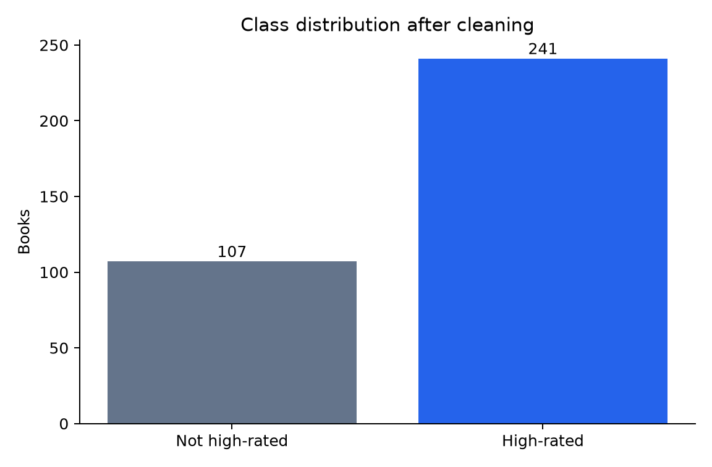
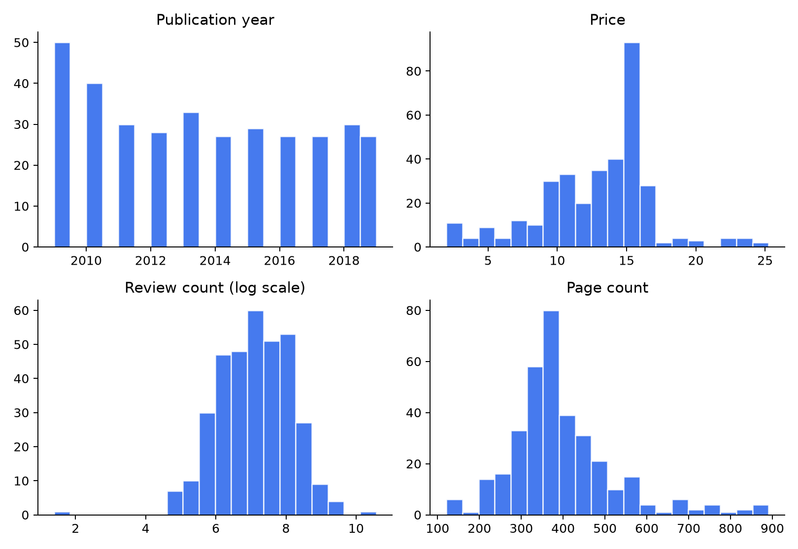
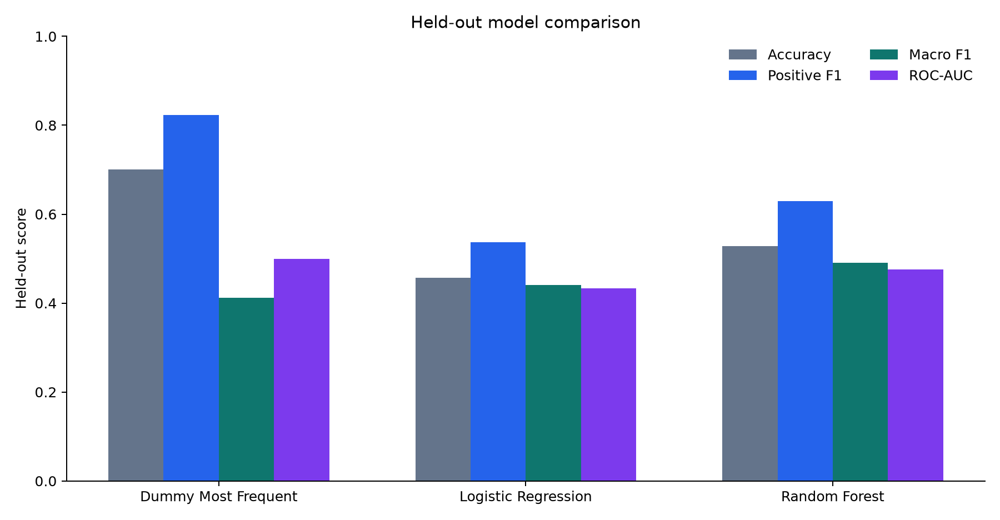
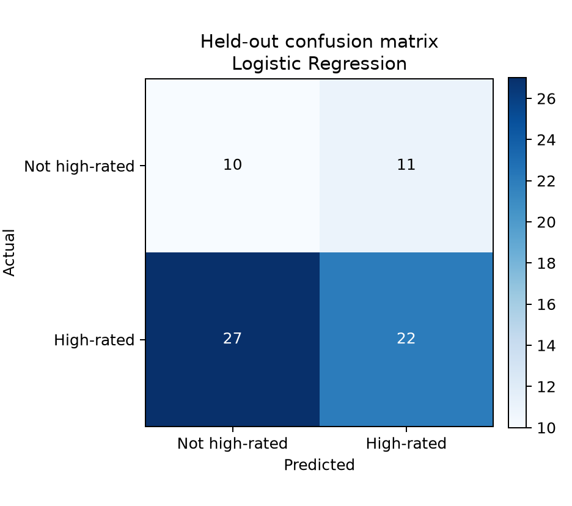

# Book High-Rating Prediction

This repository reconstructs a university machine-learning project as a reproducible binary-classification experiment. Given six book metadata fields, the model estimates whether the observed rating belongs to the **high-rating class**, defined as `rating >= 4.6`.

The project does not implement personalized recommendations, collaborative filtering, content-based ranking, or user preference modeling.

## Main finding

The reproduced models did not establish a reliable advantage over the majority-class baseline on the fixed held-out set. Logistic Regression won the training-fold macro-F1 selection, but its held-out accuracy was 0.457 and ROC-AUC was 0.433. The majority-class dummy achieved 0.700 accuracy because 69.3% of the cleaned observations are positive. This negative result is retained as part of the engineering record.

## Verified task and data

- Target: `high_rating = 1` when `rating >= 4.6`, otherwise `0`.
- Features: `year`, `price`, `num_reviews`, `num_pages`, `genre`, and `sub_genre`.
- Raw observations: 350.
- Cleaning: two rows with nonpositive prices are removed.
- Final observations: 348, with 241 positive and 107 negative examples.
- Repeated titles: one two-row title group, kept within one side of every group-aware split.
- Missing required values: none.
- Exact duplicate rows: none.

The university workbook is excluded from publication. The project report associates it with Kaggle's [Amazon Top 50 Bestselling Books 2009–2019](https://www.kaggle.com/datasets/sootersaalu/amazon-top-50-bestselling-books-2009-2019), whose data card labels the base dataset CC0. The university workbook adds and modifies fields whose provenance is not documented, so the base dataset's license is not treated as permission to redistribute the derived workbook. See [data access](data/README.md) and the [private verification summary](reports/private-data-verification.md).

## Methodology

The experiment uses a fixed, group-aware 80/20 held-out split. Model selection occurs only within the training portion using five-fold `StratifiedGroupKFold` cross-validation and mean macro F1. Repeated title editions share a normalized title group.

All fitted transformations live inside sklearn pipelines:

- Median imputation and standardization for year, price, and page count.
- Median imputation, `log1p`, and standardization for the highly skewed review count.
- Most-frequent imputation and one-hot encoding for genre and sub-genre.
- Unknown categories ignored during transformation, while the application restricts choices to trained categories.

The comparison intentionally contains only three useful model families:

- `DummyClassifier(strategy="most_frequent")`
- Logistic Regression
- Random Forest

Hyperparameters are selected with training-fold cross-validation. The winner is frozen before any held-out predictions are calculated. The selected model, predefined majority baseline, and retained Random Forest comparison are then evaluated on the holdout; those descriptive results cannot change the selected model.

## Reproduced results

### Training-only cross-validation

| Model | Accuracy | Positive F1 | Macro F1 | ROC-AUC |
|---|---:|---:|---:|---:|
| Majority dummy | 0.691 ± 0.007 | 0.817 ± 0.005 | 0.409 ± 0.002 | 0.500 ± 0.000 |
| Logistic Regression | 0.634 ± 0.076 | 0.705 ± 0.066 | **0.610 ± 0.079** | 0.652 ± 0.055 |
| Random Forest | 0.615 ± 0.039 | 0.707 ± 0.039 | 0.570 ± 0.034 | 0.623 ± 0.050 |

### Held-out test

| Model | Accuracy | Precision | Recall | Positive F1 | Macro F1 | ROC-AUC |
|---|---:|---:|---:|---:|---:|---:|
| Majority dummy | **0.700** | 0.700 | **1.000** | **0.824** | 0.412 | **0.500** |
| Logistic Regression | 0.457 | 0.667 | 0.449 | 0.537 | 0.441 | 0.433 |
| Random Forest | 0.529 | **0.700** | 0.571 | 0.629 | **0.491** | 0.476 |

Logistic Regression was selected before test evaluation because it had the strongest cross-validated macro F1. Its held-out macro F1 was only slightly above the dummy baseline, and its 95% bootstrap interval was 0.326–0.554. Random Forest scored better on held-out macro F1, but changing the selected model after viewing the test results would leak test information into model selection.

Full metrics, parameters, fold variability, confusion matrices, and aggregate error analysis are available in [the experiment report](reports/experiment-results.md) and [machine-readable metrics](reports/metrics.json).









## Public synthetic demonstration

The repository includes 24 fabricated rows so a new user can verify training, serialization, loading, and the Streamlit interface without the private workbook. Synthetic metrics and figures are written only under ignored `demo-output/`; the model is written as the ignored `models/book_rating_demo_pipeline.joblib`. These paths cannot overwrite the published real-data metrics, figures, or model path.

The synthetic rows and their feature relationships are artificial. Their predictions and evaluation metrics are software demonstrations, not evidence of real-world model performance.

After completing the installation steps below, run from the repository root.

Windows PowerShell:

```powershell
python -m book_rating.demo
$env:BOOK_RATING_MODEL_PATH = "models/book_rating_demo_pipeline.joblib"
streamlit run app.py
```

Windows Command Prompt:

```bat
python -m book_rating.demo
set BOOK_RATING_MODEL_PATH=models\book_rating_demo_pipeline.joblib
streamlit run app.py
```

Linux, macOS, or another Unix-like shell:

```sh
python -m book_rating.demo
BOOK_RATING_MODEL_PATH=models/book_rating_demo_pipeline.joblib streamlit run app.py
```

The generated demonstration report is `demo-output/demo-results.md`. It is deliberately excluded from the research report and review archive.

## Streamlit interface

The interface collects all six required features, constrains categories to the trained vocabulary, validates numeric ranges, and displays both the predicted class and an **uncalibrated model score** for the high-rating class.

It identifies whether the loaded artifact came from the private experiment or the synthetic demonstration. It also states that the score is not a verified likelihood and prominently discloses the weak held-out research result. If the model file is missing or incompatible, the interface displays the safe demonstration command instead of crashing.

```powershell
streamlit run app.py
```

## Installation

Python 3.11 or 3.12 is required. From the repository root:

Windows PowerShell:

```powershell
py -3.12 -m venv .venv
.\.venv\Scripts\Activate.ps1
python -m pip install --upgrade pip
python -m pip install -r requirements-dev.txt
python -m pip install -e .
```

Windows Command Prompt:

```bat
py -3.12 -m venv .venv
.venv\Scripts\activate.bat
python -m pip install --upgrade pip
python -m pip install -r requirements-dev.txt
python -m pip install -e .
```

Linux, macOS, or another Unix-like shell:

```sh
python3.12 -m venv .venv
. .venv/bin/activate
python -m pip install --upgrade pip
python -m pip install -r requirements-dev.txt
python -m pip install -e .
```

## Training and evaluation

Place an authorized dataset copy at the path described in [data/README.md](data/README.md), then run:

```powershell
python -m book_rating.train --data data/raw/book_rating_dataset.xlsx
```

The command writes:

- `models/book_rating_pipeline.joblib`, a local ignored artifact.
- `reports/metrics.json` and `reports/experiment-results.md`.
- Four figures generated from the real experiment.

The artifact stores the fitted preprocessing and classifier together, the expected feature order, trained categorical vocabulary, package versions, and source-data SHA-256. It contains no anonymous lambda and loads successfully in a new Python process. Only load artifacts generated locally from trusted code and data.

The research workflow is intentionally sequenced as follows:

1. Create the fixed group-aware holdout.
2. Search candidate hyperparameters using training folds only.
3. Select and freeze the winner using cross-validated macro F1.
4. Evaluate the frozen winner and predefined dummy baseline on the holdout.
5. Evaluate the retained Random Forest as a descriptive comparison that cannot alter selection.
6. Refit the already selected configuration on all verified rows for the local deployment artifact.

## Testing

```powershell
python -m pytest
```

The tests cover schema validation, cleaning, target derivation, group-aware splitting, integer and categorical input validation, feature order, training-only selection, held-out independence, serialization, loading in a new process, stable inference, the public synthetic workflow, end-to-end CLI execution, and both Streamlit artifact states.

See [testing results](reports/testing.md) for the verified environment and commands.

## Repository structure

```text
book-rating-prediction/
├── app.py
├── pyproject.toml
├── requirements.txt
├── requirements-dev.txt
├── data/
│   ├── README.md
│   └── synthetic_books.csv
├── figures/
├── models/
│   └── README.md
├── reports/
├── src/book_rating/
│   ├── demo.py
│   └── ...
└── tests/
```

## Original project and portfolio reconstruction

The original application trained one Random Forest pipeline on the full cleaned dataset and saved it without a reproducible evaluation workflow. The checked binary artifact is incomplete and contains preprocessing state without a classifier. The original reports describe additional algorithms, tuning, and SHAP analysis that are not present in the supplied source code; those values remain labeled as historical and unverified.

The portfolio edition adds dataset validation, leakage-controlled splitting, training-only model selection, a dummy baseline, uncertainty estimates, reproducible outputs, robust serialization, application validation, and automated tests. Details are in [the original-project assessment](reports/original-project-assessment.md) and [historical results](reports/historical-results.md).

## Attribution

The original university materials do not provide a consistent contributor list:

- The final report lists **Tasnim Alibraheem** and **Ranim Alyasein**.
- Stage 3 materials also list **Fatma Alzhraa Hatip**.

The supplied artifacts do not document individual task ownership, so this repository does not assign specific original components to one team member. The portfolio reconstruction and reproduced experiments were completed later under Ranim Alyasein's direction and are not presented as work performed during the original course.

## Limitations

- The dataset is small, imbalanced, and drawn from a curated bestseller collection.
- Ratings occupy a narrow range, and the 4.6 threshold is a project convention.
- Review counts may reflect exposure or popularity after publication and should not be interpreted causally.
- Small genre and sub-genre groups produce unstable estimates.
- The held-out result does not show a reliable advantage over the dummy baseline.
- The application predicts a rating class only. It cannot model individual preferences.
- No production monitoring, drift detection, API, authentication, or database is included.

## Potential future work

- Validate the approach on a larger, representative, provenance-complete book catalog before considering deployment.
- Reassess the label definition and remove post-publication exposure features if the intended use is prediction before release.

No open-source license has been selected.
